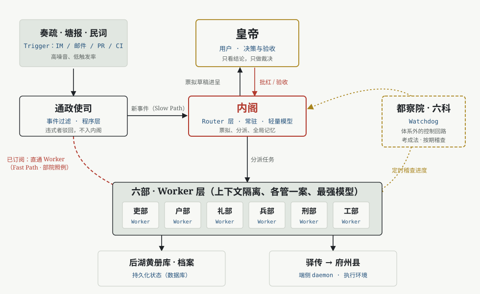

# Super Ming Agent

[English](README.md) | 中文

**一个 Agent，一座紫禁城。** Super Ming Agent（大明智能体）是 [DeepSeek Harness](https://github.com/deepseek-ai/deepseek-harness) 的个人分支，用大明官制说明 agent（智能体）的职责分工，沿用上游基于 Cordis 的“一切皆插件”架构。

目标是让人专注于决策与验收，由智能体整理上下文、执行任务并交付有用的结果。

## 名称与职责



实线表示常规流程；红色虚线表示订阅直通；金色点线表示独立监察回路。

下列名称用于解释设计，不会引入新的运行时 API，也不代表参考资料中的每项机制都已实现。本仓库包含智能体框架；面向代码仓库的编排来自独立的[上游 Super-agent 原型](https://github.com/deepseek-ai/dsh-superagent-prototype)，需要单独配置。

| Agent 概念 | 大明名称 | 类比中的职责 |
|---|---|---|
| User | 皇帝 · Emperor | 确定目标、作出决策、验收结果。 |
| Router | 内阁 · Grand Secretariat | 理解请求、协调任务、呈报结果。 |
| Router batch | 集中票拟 · Batched drafting | 集中处理积累的请求。 |
| Worker | 六部 · Six Ministries | 使用隔离的上下文和工具执行具体任务。 |
| Subagent | 清吏司 · Ministry divisions | 在单项任务内部进一步分工。 |
| Trigger | 奏疏、塘报、民词 · Incoming petitions | 接收消息与环境事件。 |
| Thread | 案卷 · Case file | 归集相关事件与引用。 |
| Rule-based filtering | 通政使司 · Transmission Office | 在语义路由之前核查来源与准入规则。 |
| Semantic filtering | 内阁阅本 · Secretariat review | 判断是否响应请求以及如何行动。 |
| Subscription bypass | 部院照例办理 · Routine handling | 将后续事件直接交给负责该案的执行者。 |
| Shared thread subscriptions | 三法司会审 · Joint review | 让多个执行者共同查看同一案卷。 |
| Inline and spill | 贴黄 · Summary slips | 就近保留摘要，需要时读取完整内容。 |
| Chained recall | 公文叙由 · Document references | 沿引用追溯此前的上下文。 |
| Speculative execution | 票拟草稿 · Draft proposals | 在呈请决策之前准备有用的工作。 |
| Asynchronous tools | 该部议奏 · Ministry deliberation | 分派任务、异步接收结果，避免阻塞其他工作。 |
| Channel-specific replies | 题本、奏本、揭帖 · Reports | 按接收渠道调整回复的形式与详细程度。 |
| Durable state | 黄册库 · Archive | 独立于执行进程保存记录。 |
| Local execution | 驿传、地方衙门 · Relay and local offices | 在文件和工具所在的环境中执行。 |
| Watchdog | 科道、考成法 · Inspection and assessment | 独立检查进度与停滞任务。 |
| Cross-agent boundaries | 南京六部 · Parallel ministries | 在隔离的上下文范围之间协调。 |
| Credentials | 勘合、印信 · Tallies and seals | 核验权限并控制凭据使用。 |

历史对应是经过简化的说明。Router、Worker 和 Watchdog 等术语描述的是链接中的设计；此表不是已实现功能清单。

<a id="run"></a>

<a id="run-from-source"></a>

## 从源码运行

需要 Node.js >= 24.9.0 和 pnpm 11.28.5，具体要求见 [package.json](package.json)。

```sh
git clone https://github.com/LucianVane/Super_Ming_Agent.git
cd Super_Ming_Agent
corepack enable
pnpm install
DSH_CLIENT_TITLE="Super Ming Agent" pnpm run build
pnpm dsh web
```

构建时的 `DSH_CLIENT_TITLE` 设置浏览器标题。在 PowerShell 中，请先设置 `$env:DSH_CLIENT_TITLE = "Super Ming Agent"`，再执行 `pnpm run build`。Web UI 默认在 `http://127.0.0.1:3080` 启动；传入 `--no-open` 可不打开浏览器。模型与凭据配置见 [Web UI 指南](docs/user/guide/index.zh.md)。

CLI（命令行界面）仍使用 `dsh`，工作区包保留 `@deepseek-ai/*` 名称，现有配置路径保持兼容。`npx @deepseek-ai/dsh web` 安装的是上游发行版；运行 Super Ming Agent 请使用本仓库源码。

## 开发

阅读[开发指南](docs/development.zh.md)、[架构说明](docs/architecture.zh.md)和[贡献指南](CONTRIBUTING.zh.md)。智能体应遵循 [AGENTS.md](AGENTS.md)。

```sh
pnpm run dev:web
pnpm run test
pnpm run typecheck
```

分支特有问题请提交到[本仓库](https://github.com/LucianVane/Super_Ming_Agent/issues)。继承的代码处于开发者预览阶段，可能出现破坏兼容性的变更。运行前请阅读[安全说明](SAFETY.zh.md)。

## 归属与许可

Super Ming Agent 由 LucianVane 作为个人分支维护。DeepSeek Harness 由 DeepSeek AI 开发，基于 [Cordis](https://github.com/cordiverse/cordis)。本项目采用独立名称，不是 DeepSeek 官方发行版。

设计讨论参考 DeepSeek 的 [Super-agent 设计探索](https://zhuanlan.zhihu.com/p/2099987320443237060)。本 README 概括其设计类比，不复刻文章全文或实验结论。

保留上游 MIT 许可证及第三方声明。详见 [LICENSE](LICENSE) 和 [THIRD_PARTY_NOTICES.md](THIRD_PARTY_NOTICES.md)。
